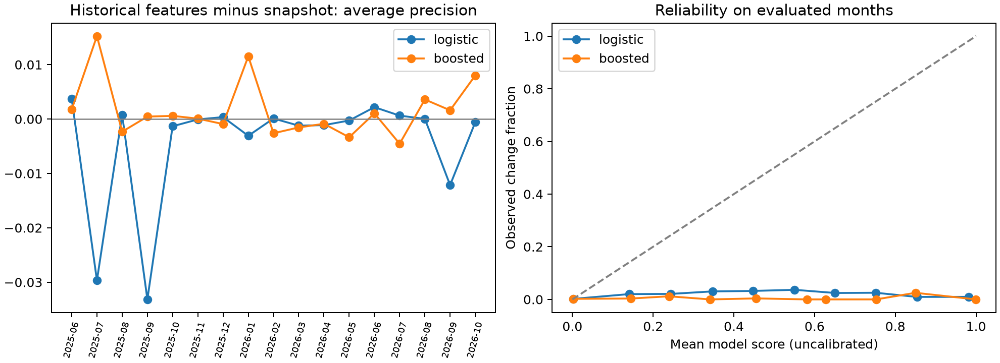

# Kerykeion: measured results

Dataset: 23 monthly releases, 2025-01 through 2026-11; BRCA1, BRCA2 and TP53.

Saved latest runs: 348. The first six releases supply warm-up; paired reporting uses origins with available endpoint outcomes. Horizon 1 is primary and horizon 3 secondary.

## Temporal versus snapshot inputs

| Method | Horizon | Evaluated origins | Mean AP difference | 95% release-block interval |
|---|---:|---:|---:|---|
| logistic | 1 | 17 | -0.00440 | [-0.009480337007271822, -0.0004450837219614909] |
| logistic | 3 | 15 | -0.00209 | [-0.005001956397992595, 0.0005453673557465381] |
| boosted | 1 | 17 | 0.00163 | [-0.0006665155228878509, 0.003947674090514102] |
| boosted | 3 | 15 | -0.00330 | [-0.008958203517929066, 0.002701378884401835] |

Intervals resample paired release blocks of length 3, 2,000 times with seed 42. They describe variability in this three-gene panel; they do not establish clinical validity or generalisation to other genes. Shared variants and few origins remain limitations.

There are 547 variant-release reconstruction mismatches, listed in source_mismatches.csv. Primary labels concern the documented reconstruction. per_gene_metrics.csv includes a secondary analysis restricted to endpoints matching the official archive groups.

A no-change or negative model result is retained. Latest origins without future endpoints are predictions with unknown outcomes, not negative outcomes. Model scores are not calibrated probabilities.

No hyperparameter search used future test outcomes. Static-versus-temporal is the primary feature-group ablation; additional sensitivity experiments are stored separately when run.

